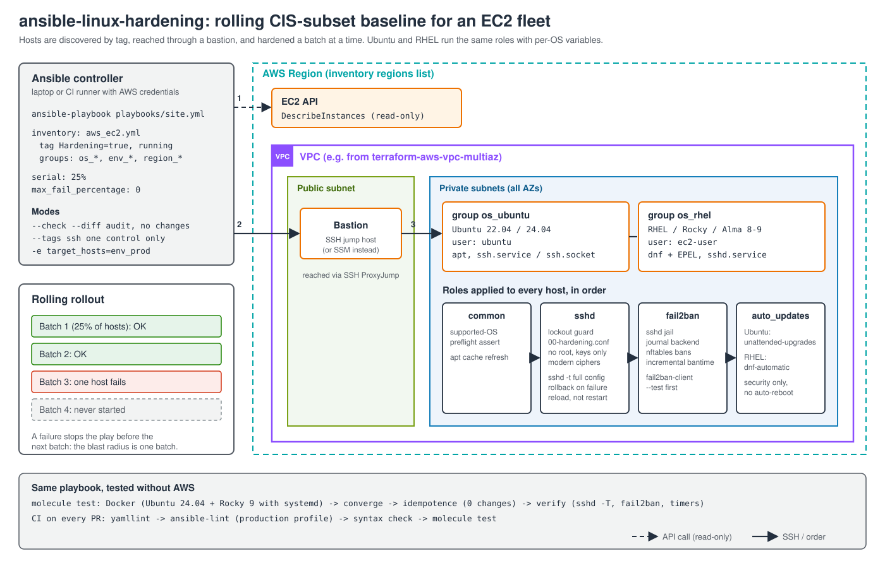

# ansible-linux-hardening

[](https://github.com/johnvega-cloud/ansible-linux-hardening/actions/workflows/ci.yml)

Ansible playbook and roles that apply a CIS-benchmark subset to a fleet of
Ubuntu and RHEL EC2 instances: no root SSH, a hardened sshd configuration,
fail2ban, and automatic security updates. It is safe to re-run, rolls out in
batches, and refuses changes that could lock you out.

## Problem it solves

A fleet built from different AMIs drifts: one image allows password logins,
another lets root in, nobody remembers which hosts get security patches. Fixing
that by hand does not scale and is not repeatable. This project defines the
baseline once and applies it to every instance tagged `Hardening=true`,
whatever its distribution. You can also run it in `--check --diff` mode to
audit the fleet without changing anything.

## Architecture



1. The **EC2 dynamic inventory** asks the EC2 API for running instances tagged
   `Hardening=true` and groups them by OS, environment and region.
2. Ansible connects over **SSH through a bastion** (ProxyJump) to the private IPs.
3. The play runs **25% of the fleet at a time**. If any host fails, the play
   stops before the next batch.
4. Every host gets the same four roles. Per-OS differences live in each
   role's `vars/Debian.yml` and `vars/RedHat.yml`, not in duplicated tasks.

See [docs/BUILD_GUIDE.md](docs/BUILD_GUIDE.md) for the build order and the
design decisions.

## Controls

| Control | Role | Implementation |
|---|---|---|
| Disable root SSH login | `sshd` | `PermitRootLogin no` |
| Key-only authentication | `sshd` | `PasswordAuthentication no`, `PermitEmptyPasswords no`, `ChallengeResponseAuthentication no`, `HostbasedAuthentication no`, `IgnoreRhosts yes` |
| Brute-force limits | `sshd` | `MaxAuthTries 4`, `LoginGraceTime 60`, `MaxStartups 10:30:60`, `MaxSessions 10` |
| Idle session timeout | `sshd` | `ClientAliveInterval 300`, `ClientAliveCountMax 3` |
| Reduce attack surface | `sshd` | `X11Forwarding no`, `AllowTcpForwarding no`, `AllowAgentForwarding no`, `PermitUserEnvironment no` |
| Strong cryptography | `sshd` | AEAD/CTR ciphers, ETM SHA-2 MACs, curve25519/DH group 16+ key exchange (no CBC, SHA-1 or MD5) |
| Logging and banner | `sshd` | `LogLevel VERBOSE` (logs key fingerprints), `Banner /etc/issue.net` |
| Config file permissions | `sshd` | `sshd_config` and the drop-in owned by root, mode `0600` |
| Optional login allow-list | `sshd` | `AllowGroups` from `sshd_allow_groups` |
| Brute-force banning | `fail2ban` | sshd jail, aggressive mode, 5 failures in 10 min → 1 h ban, doubling for repeat offenders (max 1 week) |
| Automatic security updates | `auto_updates` | Ubuntu: `unattended-upgrades` + apt timers. RHEL: `dnf-automatic` with `upgrade_type = security` + timer |

The controls follow the "SSH Server", fail2ban and patching recommendations of
the CIS Ubuntu Linux and CIS Red Hat Enterprise Linux benchmarks. Section
numbers change between benchmarks and versions, so this table maps controls by
name, not by number. This is a **subset** of those benchmarks, not a full CIS
Level 1 implementation.

## Repository layout

```text
.
├── ansible.cfg
├── requirements.txt            # pinned controller tooling (ansible-core, lint, molecule)
├── requirements.yml            # collections (amazon.aws, community.general, ...)
├── inventories/
│   ├── aws_ec2.yml             # EC2 dynamic inventory (tag Hardening=true)
│   ├── static.example.yml      # static inventory template
│   └── group_vars/all.yml      # bastion, fleet-wide overrides
├── playbooks/site.yml          # rolling play: common → sshd → fail2ban → auto_updates
├── roles/
│   ├── common/                 # preflight: supported OS, apt cache
│   ├── sshd/                   # hardened drop-in, lockout guard, validation + rollback
│   ├── fail2ban/               # sshd jail, EPEL on RHEL
│   └── auto_updates/           # unattended-upgrades / dnf-automatic
├── molecule/default/           # Docker test: Ubuntu 24.04 + Rocky 9
└── docs/                       # architecture diagram, build guide
```

## Prerequisites

- Python 3.11+ on the controller, plus the pinned tooling and collections:

  ```bash
  python3 -m venv .venv && source .venv/bin/activate
  pip install -r requirements.txt
  ansible-galaxy collection install -r requirements.yml
  ```

- AWS credentials on the controller with `ec2:DescribeInstances` (for the inventory only).
- Target instances tagged `Hardening=true` and `OS=ubuntu` or `OS=rhel`.
  The `OS` tag picks the login user (`ubuntu` / `ec2-user`). Official Rocky
  AMIs log in as `rocky`: set `ansible_user` in `group_vars` for those.
- SSH access with a key: through a bastion (`hardening_bastion` in
  `inventories/group_vars/all.yml`) or directly. The connecting user needs `sudo`.
- Supported targets: Ubuntu 22.04 / 24.04 and RHEL / Rocky / AlmaLinux 9.
  EL8 is **not** supported: ansible-core 2.17+ cannot run modules on its
  system Python (3.6), and the `dnf` module needs that Python's bindings.
  Managing EL8 means pinning ansible-core 2.16, which is end-of-life.

## Usage

```bash
# 1. Check what the inventory sees
ansible-inventory --graph

# 2. Audit: report what would change, change nothing
ansible-playbook playbooks/site.yml --check --diff

# 3. Apply to one environment first
ansible-playbook playbooks/site.yml -e target_hosts=env_dev

# 4. Then the rest of the fleet
ansible-playbook playbooks/site.yml
```

Other useful runs:

```bash
# Only one control
ansible-playbook playbooks/site.yml --tags ssh        # or fail2ban, updates

# Smaller batches for a sensitive environment
ansible-playbook playbooks/site.yml -e target_hosts=env_prod -e hardening_serial=10%

# Hosts outside AWS
cp inventories/static.example.yml inventories/static.local.yml   # edit, git-ignored
ansible-playbook -i inventories/static.local.yml playbooks/site.yml
```

`hardening_serial` must be passed with `-e`: Ansible evaluates `serial` once per
play, before inventory variables exist.

## Main variables

All defaults live in `roles/<role>/defaults/main.yml`. Override them in
`inventories/group_vars/` (per group) or with `-e`.

| Variable | Default | Purpose |
|---|---|---|
| `sshd_password_authentication` | `false` | Allow password logins |
| `sshd_allow_groups` | `[]` | Only these groups may log in (empty = no restriction) |
| `sshd_max_auth_tries` | `4` | Failed attempts per connection |
| `sshd_ciphers` / `sshd_macs` / `sshd_kex_algorithms` | modern lists | Allowed algorithms (all available in OpenSSH 8.7+) |
| `sshd_lockout_guard` | `true` | Stop before any change if the new config would lock out the login user |
| `sshd_login_user` | `ansible_user` | User the lockout guard checks |
| `fail2ban_maxretry` / `fail2ban_findtime` / `fail2ban_bantime` | `5` / `10m` / `1h` | Ban policy |
| `fail2ban_ignoreip_extra` | `[]` | Never ban these CIDRs: add the bastion or admin network |
| `fail2ban_manage_epel` | `true` | Install EPEL on RHEL family |
| `auto_updates_type` | `security` | `security` or `default` (all updates) |
| `auto_updates_reboot` | `false` | Reboot automatically when an update needs it |

## Security notes

- **Lockout protection.** Before changing anything, the `sshd` role checks
  that the user Ansible logs in as can still log in afterwards: it is not
  `root` (the baseline sets `PermitRootLogin no`), it has a non-empty
  `authorized_keys`, and it belongs to `sshd_allow_groups` when that list is
  set. If you reach instances through SSM instead of SSH, set
  `sshd_lockout_guard: false`.
- **Validation and rollback.** After writing the drop-in, the role runs
  `sshd -t` on the full configuration (main file plus every drop-in). If it
  fails, the role undoes only what this run changed: it restores the previous
  drop-in, or removes it if it was new. If the drop-in did not change, the
  error is in another file and the drop-in stays (removing it would re-enable
  password logins). Either way the host is marked failed and sshd is not
  reloaded into a broken config.
- **Reload, not restart.** Config changes are applied with
  `systemctl try-reload-or-restart`: existing sessions, including Ansible's
  own, stay connected.
- **Drop-in precedence.** sshd keeps the first value it reads for most options.
  The baseline lives in `sshd_config.d/00-hardening.conf`, which is read before
  distribution and cloud-init drop-ins such as `50-cloud-init.conf`.
- **RHEL crypto policies.** RHEL 9 loads the system crypto policy through
  `50-redhat.conf`. The `00-` drop-in is read first, so its cipher lists win.
  On FIPS hosts some algorithms (e.g. chacha20-poly1305) are not allowed:
  override `sshd_ciphers` / `sshd_macs` / `sshd_kex_algorithms`, or `sshd -t`
  fails and the rollback keeps the previous config.
- **Ubuntu 24.04 socket activation.** sshd starts from `ssh.socket` there. The
  role enables the socket, not `ssh.service`, so the two do not fight over port 22.
  Hosts where an admin switched back to `ssh.service` need
  `sshd_activation_unit: ssh.service`.
- **fail2ban allow-list.** Add your bastion or admin CIDR to
  `fail2ban_ignoreip_extra`. Otherwise a misconfigured key on the bastion can
  get the bastion itself banned.
- **No secrets in the repository.** The inventory reads AWS credentials from
  the environment. Vault password files and local inventories are git-ignored.

## Idempotency and safe changes

- Every task describes a desired state (`template`, `lineinfile`, `ini_file`,
  `package`, `systemd_service`). The only `command` tasks are read-only checks
  (`changed_when: false`), `ssh-keygen -A` (guarded by `creates:`) and the reload handler.
- Molecule converges twice and fails if the second run reports any change.
- Handlers only fire when a file they watch changed, so a re-run on a compliant
  host restarts nothing.
- `--check --diff` is a compliance audit. On a host that is missing a package
  (e.g. fail2ban), the audit reports the install and skips that package's
  configuration instead of failing. On a compliant host it reports 0 changes.
  Molecule tests both cases.

## Testing and CI

```bash
yamllint .
ansible-lint                     # production profile
molecule test                    # needs Docker
```

`molecule test` starts Ubuntu 22.04, Ubuntu 24.04 and Rocky Linux 9 containers
with systemd (Rocky stands in for RHEL 9), then:

1. **check**: runs the playbook in `--check` mode on the unhardened
   containers: the audit mode must not fail;
2. **converge**: runs `playbooks/site.yml`, the same playbook used on the fleet;
3. **idempotence**: runs it again and fails on any change;
4. **verify**, in two parts:
   - **state**: the *effective* sshd configuration (`sshd -T`), sshd_config
     permissions, the fail2ban jail, `apt-config dump`, the dnf-automatic
     config and the update timers;
   - **behaviour**: each host is brute-forced over SSH by another container
     and must ban it in nftables; the lockout guard must reject root, a user
     without a key and a user outside `AllowGroups`, and accept a valid user;
     an invalid sshd value must be rolled back; a broken unrelated sshd file
     must fail the run without deleting the hardening drop-in.

GitHub Actions runs lint, syntax check and Molecule on every push and pull
request. CI never touches AWS. `main` is protected: changes go through a PR
with green CI.

### Limitations

- Containers share the host kernel, so Molecule cannot test kernel-level
  behaviour or a real reboot. The tests cover configuration, services and
  idempotence.
- RHEL itself is not in CI (it needs a subscription). Rocky Linux 9 runs the
  same packages. The RHEL-only branch (EPEL from the Fedora URL and its GPG
  key) is covered by lint and syntax checks only.
- The lockout guard is tested directly (`tasks_from: guard`). Its trigger in
  `main.yml` only runs over SSH, which Molecule does not use (it connects with
  `docker exec`).
- Changing the SSH port on RHEL also needs an SELinux port label
  (`semanage port`), which this project does not manage.

## Requirements

| Tool | Version |
|---|---|
| ansible-core | 2.19 (pinned in `requirements.txt`) |
| Python (controller) | 3.11+ |
| Collections | `amazon.aws` ≥ 9, `community.general` ≥ 10, `community.docker` ≥ 4 |
| Docker | for Molecule only |

## Author

John Vega
