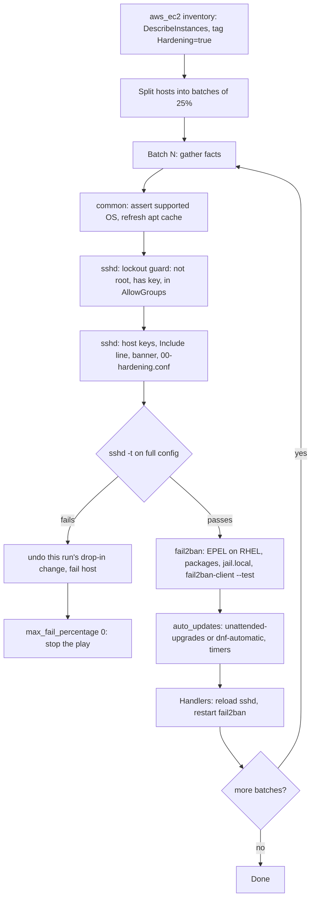

# Build guide: what gets built first, and why

This guide explains the project in two orders:

1. **Authoring order**: how to write this repository from scratch, step by step.
   Each step only depends on what the previous steps already defined.
2. **Execution order**: what happens, host by host and task by task, when the
   playbook runs against a fleet.

---

## 1. Authoring order (how to build the repository)

The commit history follows these steps, so `git log --reverse` shows the same path.

| Step | Files | What | Why it comes here |
|---|---|---|---|
| 0 | — | **Design on paper**: which CIS controls, which distros, how to reach the hosts, how to avoid a lockout | A hardening baseline that locks out its operator is worse than none. The safety model (lockout guard, validation, rolling batches) is decided before any task is written. |
| 1 | `.gitignore`, `ansible.cfg`, `requirements.*` | Skeleton, pinned tooling and collections | Vault password files and local inventories with real IPs must be ignored **before** they exist. Pinned versions make CI reproducible. |
| 2 | `roles/common` | Preflight: fail on unsupported OS | Every other role branches on `os_family`. An unknown distro must stop here, not end up half-hardened. |
| 3 | `roles/sshd` | Hardened sshd drop-in, lockout guard (`guard.yml`), validation and rollback | The highest-risk control, so it gets the most safety code. It is also the one the task names twice (root login + strong SSH config). |
| 4 | `roles/fail2ban` | sshd jail | Depends on the SSH port decided in step 3. On RHEL it needs EPEL, so the repo setup lives in this role. |
| 5 | `roles/auto_updates` | unattended-upgrades / dnf-automatic | Independent of SSH; last because it is the lowest-risk change. |
| 6 | `playbooks/site.yml`, `inventories/` | Rolling play, EC2 dynamic inventory | Roles do nothing until a play applies them. The inventory turns "the fleet" into groups (`os_*`, `env_*`, `region_*`). |
| 7 | `molecule/` | Check, converge, idempotence, state and behaviour verify on Ubuntu 22.04/24.04 + Rocky 9 | Locks in the behaviour on both OS families without AWS. The behaviour tests attack the hosts and break sshd on purpose, because a control that is configured is not the same as a control that works. |
| 8 | `.yamllint`, `.ansible-lint`, `.github/workflows/ci.yml` | Lint and tests on every PR | Automates steps 2–7 as a gate: `main` is protected and only accepts changes that pass CI. |
| 9 | `README.md`, `docs/` | Usage, controls, safety, diagrams | Documents what was actually built, so it is written last. |

### Key decisions made in step 0

| Decision | Choice | Reason |
|---|---|---|
| Config method for sshd | A drop-in `sshd_config.d/00-hardening.conf`, not editing `sshd_config` line by line | For most sshd options the **first** value wins. A `00-` file is read before distro and cloud-init drop-ins (e.g. `50-cloud-init.conf` turning passwords back on). One template is easier to review than twenty `lineinfile` tasks. |
| Validate what | `sshd -t` on the **whole** config after writing the drop-in | Validating the new file alone misses conflicts with other files. If validation fails, the previous file is restored, so a reboot cannot start sshd with a broken config. |
| Apply how | `reload` (via `systemctl try-reload-or-restart`), not `restart` | Reload keeps existing sessions, including Ansible's own, alive. |
| Lockout guard | Before any change, check the login user is not root, has `authorized_keys` and is in `AllowGroups` | The one mistake that turns a hardening run into a console-recovery incident. |
| Rollback scope | Undo only what this run changed | If the drop-in did not change, the error is in another file; deleting the drop-in would re-enable password logins. |
| Supported releases | Ubuntu 22.04/24.04, EL9 | ansible-core 2.17+ cannot manage EL8 (system Python 3.6). |
| Rollout | `serial: 25%`, `max_fail_percentage: 0` | A bad change hits one batch, then the play stops. |
| fail2ban backend | `systemd` journal + `nftables` | Same on Ubuntu and RHEL; works on images without rsyslog; nftables is the native filter on all supported releases. |
| Updates scope | Security only, no automatic reboot | Lowest-risk default. Reboots in a fleet belong to a coordinated process (patch window, ASG instance refresh). |
| Test platform | Docker containers running systemd | Exercises services, timers and handlers like a VM does, in seconds and without AWS costs. |

---

## 2. Execution order (what happens on each run)

Within a batch, Ansible runs each task on all hosts of the batch in parallel
(`forks = 20`), then moves to the next task. Handlers run once per host, at the
end of the play for that batch, and only if something they listen to changed.
On a second run nothing changes, so no handler fires: that is what the Molecule
idempotence step checks.
